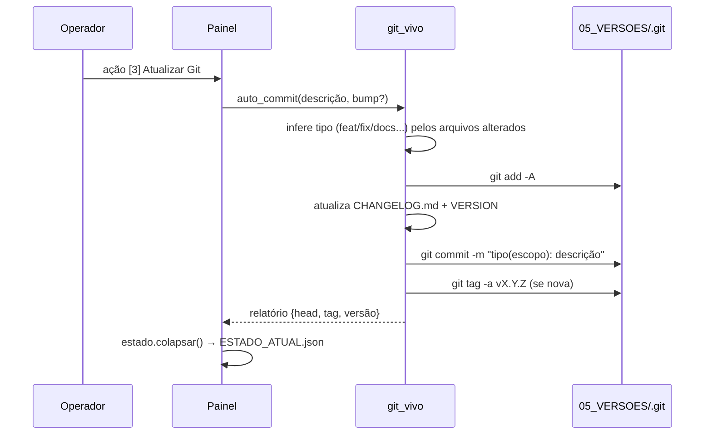

<!-- TECHDIM INOVA SIMPLES (I.S.) - ME 61.933.926/0001-24 | www.techdim.com.br -->
<!-- ID-TECHDIM: TECHDIM-PROJ-PROTOCOLO-v2.1.0 -->
# Como Funciona

## Visão de alto nível (sem código)

1. Você copia a pasta do organismo para qualquer máquina.
2. Roda `iniciar.sh` / `INICIAR.bat` / `python3 INICIAR_UNIVERSAL.py`.
3. O organismo **se localiza** (acha sua própria RAIZ pelo par `VERSION` + `05_VERSOES/`).
4. **Escaneia a máquina** e escreve um retrato dela (sem dados pessoais sensíveis).
5. **Liga o Git Vivo** em `05_VERSOES/` (cria o repositório se ainda não existe).
6. **Se auto-audita**: estrutura, integridade, caminhos, segurança, Git, ambiente.
7. **Colapsa tudo** num Estado Quântico 🟢/🟡/🔴 salvo em `ESTADO_ATUAL.json`.
8. **Abre o Painel** — a partir daí, tudo é ação numerada.

## Arquitetura técnica

```
                    ┌────────────────────────────┐
                    │   INICIAR_UNIVERSAL.py      │  (lançador multiplataforma)
                    └─────────────┬──────────────┘
                                  │ importa
                    ┌─────────────▼──────────────┐
                    │        techdim_core/       │  (100% stdlib, sem pip)
                    ├────────────────────────────┤
   raiz.py ─────────┤ descobre a RAIZ, resolve caminhos relativos
   confinamento.py ─┤ gate de gravação · varredura red-team · bwrap/firejail
   maquina.py ──────┤ SO/arch/host/user/disco/RAM/CPU/VM · Android tools · hash
   integridade.py ──┤ SHA-256 · checksums.txt · Prova de Integridade
   estado.py ───────┤ Estado Quântico · Estado do Operador · memória episódica
   git_vivo.py ─────┤ add + commit convencional + tag + CHANGELOG + VERSION
   auditoria.py ────┤ motor das 6 auditorias + AUDITORIA_COMPLETA.md
   painel.py ───────┤ CLI rico (cores ANSI) · checklist ao vivo · 10 ações
                    └─────────────┬──────────────┘
                                  │ lê / escreve (sempre via gate)
    ┌──────────┬──────────┬───────┴────┬───────────┬───────────┬──────────┐
 00_AUDITORIA 01_SOBRE  02_COMO_USAR 03_APLICACAO 04_INTELIG. 05_VERSOES 06_MIDIA
```

- **Sem dependências externas**: `techdim_core/` importa apenas `os`, `sys`, `pathlib`,
  `hashlib`, `json`, `subprocess`, `platform`, `socket`, `struct`, `zlib`, `re`, `datetime`.
- **Ferramentas do SO** (`git`, `adb`, `bwrap`) são **opcionais**: se ausentes, o organismo
  degrada com elegância e registra a ausência — nunca quebra.
- **Toda escrita** passa por `confinamento.exigir_dentro_da_raiz()`. Um `shutil.rmtree` fora
  da RAIZ é impossível pelo caminho normal do código.

## Fluxo de dados de uma modificação (Git Vivo)



Detalhes de cada decisão em [[02_decisoes_tecnicas]]; lista completa de recursos em [[03_funcionalidades]].
