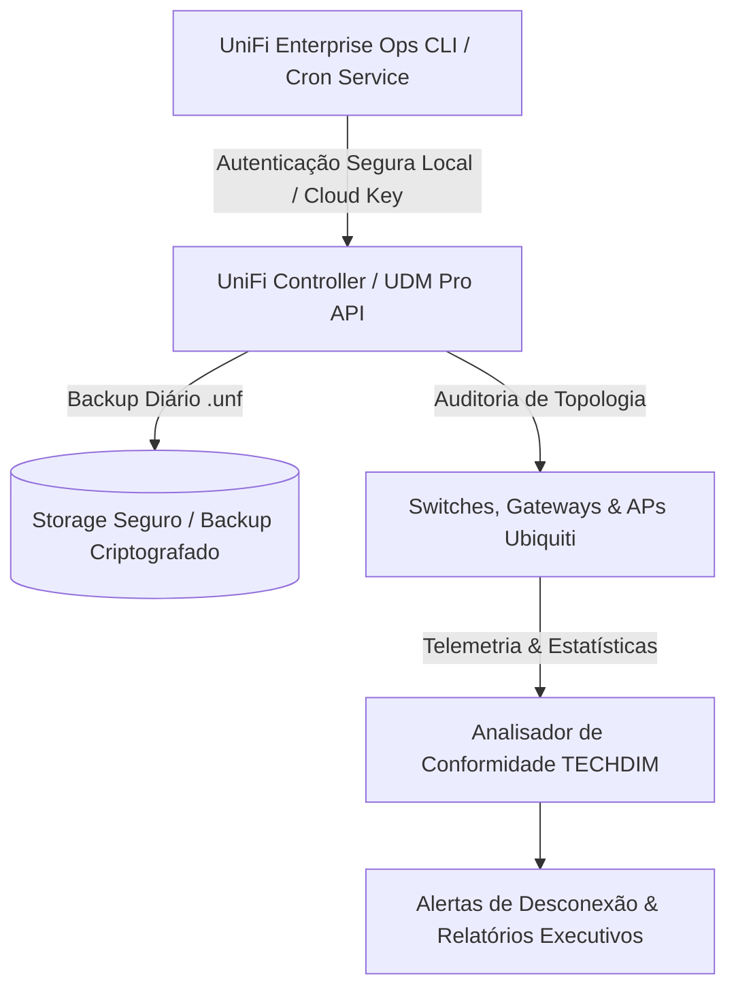

# 🌐 UniFi Enterprise Ops Toolkit
## Toolkit Corporativo para Automação, Backup e Auditoria de Redes UniFi / UniFi OS (UDM-Pro / UDM-SE)


[](https://techdimbr.github.io/techdimbr/)
[](https://www.techdim.com.br)
[](https://ui.com)
[](https://www.python.org)
[](README.md)
[](LICENSE)

> **Automação determinística para infraestruturas de rede Ubiquiti UniFi. Backup automatizado de configurações, provisionamento padronizado de VLANs corporativas segmentadas e monitoramento contínuo de integridade de switches, gateways e access points.**

---

## 🏛️ Visão Geral & Proposta de Valor

Redes corporativas UniFi frequentemente sofrem com a falta de rotinas automáticas de backup externo e configurações manuais de VLANs propensas a falhas humanas de isolamento (ex.: dispositivos IoT ou convidados na mesma rede de servidores).

O **UniFi Enterprise Ops Toolkit** automatiza o ciclo de vida da infraestrutura:
1. **Backup Criptografado Programado:** Exporta arquivos de backup da controladora (`.unf`) diariamente com encriptação e envio para armazenamento seguro fora do equipamento.
2. **Matriz de VLANs Padronizada:** Provisiona e valida a segregação de tráfego (Gerência, Corporativa, CFTV, IoT, Visitantes com isolamento L2/L3).
3. **Auditoria de Saúde de Dispositivos:** Mapeia portas de switches com erros de CRC, access points sobrecarregados e detecta quedas em tempo quase real.

---

## 🏗️ Topologia de Automação UniFi



---

## ⚡ Início Rápido

### Comandos de Operação
```bash
# 1. Clonar o repositório
git clone https://github.com/Techdimbr/unifi-enterprise-ops-toolkit.git
cd unifi-enterprise-ops-toolkit

# 2. Inicializar o ambiente
./iniciar.sh

# 3. Executar o inventário e auditoria simulada de topologia
python3 03_APLICACAO/src/unifi_ops.py --demo
```

---

## 🛡️ Governança & Contato Corporativo
- **Autor:** Deivis Írio Mayer (Kether_1)
- **Entidade:** TECHDIM INOVA SIMPLES (I.S.) - ME · CNPJ 61.933.926/0001-24
- **Website Oficial:** [https://www.techdim.com.br](https://www.techdim.com.br)
- **Portal de Soluções:** [https://techdimbr.github.io/techdimbr/](https://techdimbr.github.io/techdimbr/)
